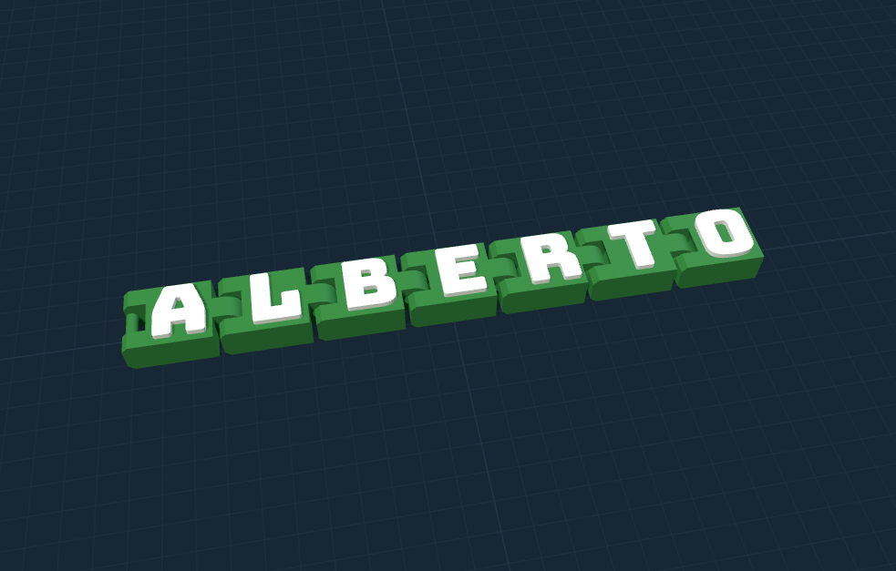
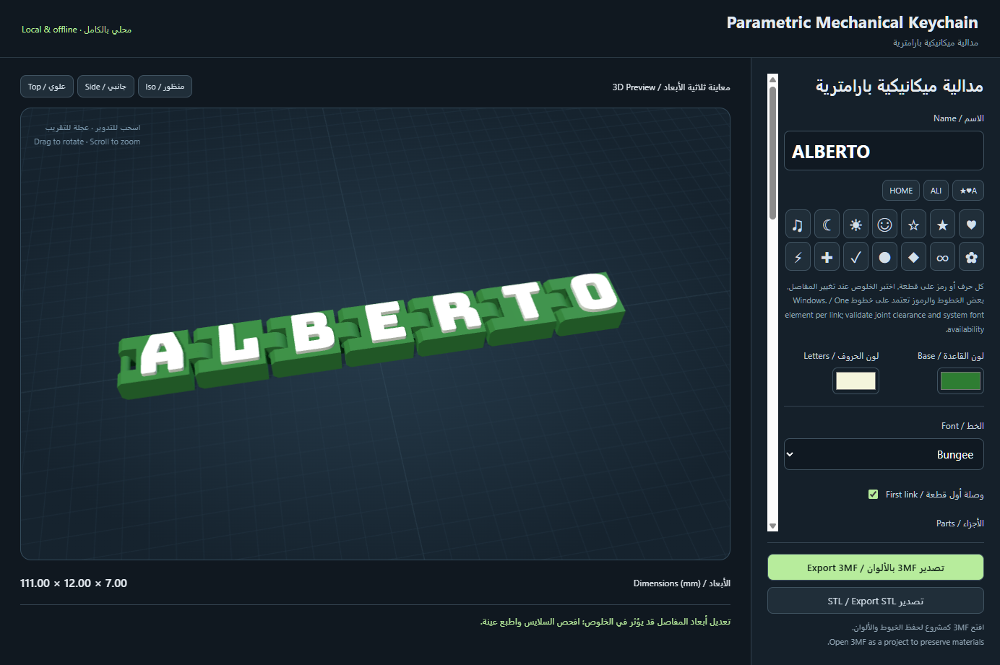

# مدالية ميكانيكية بارامترية

[English](README.md) · [تحميل نسخة Windows](https://github.com/music-dj/parametric-mechanical-keychain/releases/latest)

إنشاء مدالية قطع متحركة، حرف أو رمز لكل قطعة، اعتماداً على قالب OpenSCAD المرفق للمصمم Alberto Nicas، مع امتداد منفصل للرموز. يحتوي قائمة فعلية من 16 خطاً و14 زر إدراج أو استبدال رمز، ونص بارز أو محفور، وأوضاع القاعدة أو النص أو الكل، وخيار الوصلة الأولى، وجميع إعدادات القطع والتجويف والمحور والحلقات والدعامات والتباعد والشطفة.





## تشغيل البرنامج

1. نزّل ملف Windows ZIP من [الإصدارات](https://github.com/music-dj/parametric-mechanical-keychain/releases/latest).
2. فك ضغط الملف بالكامل إلى مجلد عادي.
3. شغّل `ParametricMechanicalKeychain.exe` واترك بقية الملفات بجانبه.
4. اكتب الاسم وعدّل الإعدادات ودوّر المعاينة، ثم صدّر STL أو 3MF بالألوان.

البرنامج يعمل محلياً دون حساب أو إنترنت. النسخة محمولة وليست مثبتاً، وهي غير موقعة رقمياً.

## التصدير والأبعاد

الأبعاد بالملمتر. STL يحفظ الشكل فقط. 3MF يحفظ الأجزاء بألوانها، مع إعدادات خيوط Bambu Studio وOrcaSlicer. افتحه كمشروع وراجع توزيع الألوان. لا يرفق البرنامج بروفايل طابعة أو معايرة خيوط. تفسير الألوان يعتمد أيضاً على برنامج التقطيع. توجد نماذج مصدّرة في [examples](examples).

## الإعدادات

يتوفر حقل الاسم ومحددا اللون دائماً.

| الحقل | الوصف | الافتراضي |
| --- | --- | --- |
| `mechanicalFont` | الخط / Font | `Bungee` |
| `eslabon_primer_elemento` | وصلة أول قطعة / First link | `true` |
| `mechanicalMode` | الأجزاء / Parts | `todo` |
| `tamano_letra` | حجم الخط (mm) | `10` |
| `altura_letra` | ارتفاع النص (+ بارز / − محفور) (mm) | `1` |
| `alto` | سماكة القطعة Z (mm) | `6` |
| `ancho` | عرض القطعة Y (mm) | `12` |
| `largo` | طول القطعة X (mm) | `15` |
| `diametro_agujero` | قطر تجويف المفصل (mm) | `10` |
| `profundidad_agujero` | طول تجويف المفصل (mm) | `5.5` |
| `diametro` | قطر محور المفصل (mm) | `2` |
| `espacio_entre_modelos` | المسافة بين القطع (mm) | `1` |
| `diametro_externo_cilindro` | قطر حلقة الوصلة الخارجي (mm) | `6` |
| `diametro_interno_cilindro` | قطر حلقة الوصلة الداخلي (mm) | `3` |
| `altura_cilindro` | عرض حلقة الوصلة (mm) | `4` |
| `separacion_cilindro` | إزاحة الحلقة عن القطعة (mm) | `2` |
| `alto_soporte` | سماكة دعامة الحلقة (mm) | `1` |
| `largo_soporte` | طول دعامة الحلقة (mm) | `2` |
| `tamano_chaflan` | شطفة طرف القطعة (mm) | `1` |

## الحدود والفحص

خط Bungee مرفق. الخطوط الإضافية وSegoe UI Symbol تعتمد على خطوط Windows المثبتة، وقد يستبدل OpenSCAD الخط غير الموجود. تغيير الخط قد يؤثر في الملاءمة. افحص الخلوص بعد تعديل المفاصل. هذا تصميم حرف لكل قطعة، وليس كتابة عربية متصلة.

نجحت اختبارات الشبكات المغلقة والحجم الموجب والإدخال غير الصحيح والتصدير بصيغتي STL و3MF. اختُبرت الواجهة وتعديل القيم واستعادة الافتراضي، وكذلك نسخة EXE المجمعة. راجع [تقرير الهندسة](docs/geometry-test.json) و[تقرير الواجهة](docs/ui-test.json). لم تُنفذ طباعة فعلية؛ اطبع عينة قصيرة قبل الإنتاج.

## تشغيل السورس وبناء EXE

تحتاج Node.js 22 أو أحدث وnpm. نفّذ داخل مجلد المشروع:

```powershell
npm ci
npm start
npm test
npm run test:ui
npm run build:windows
```

للسورس: ثبّت OpenSCAD 2021.01 وعيّن `OPENSCAD_PATH` لمسار ملف تشغيله. للبناء عيّن `OPENSCAD_DIR` لمجلد تثبيته؛ نسخة Windows الجاهزة تتضمن المحرك. ينتج البناء مجلداً محمولاً داخل `dist/parametric-mechanical-keychain-windows`. احتفظ بكل محتوياته معاً.

## الحقوق

البرنامج مستقل، ولا يحتوي تابات المشاريع الأخرى. ترخيص كود التطبيق في [LICENSE](LICENSE)، مع استثناءات حقوق النماذج والأصول في [ATTRIBUTION.md](ATTRIBUTION.md). تراخيص الخطوط مرفقة داخل `assets`. محرك OpenSCAD منفصل بترخيص GPL؛ [سورسه](https://github.com/openscad/openscad/tree/openscad-2021.01).
