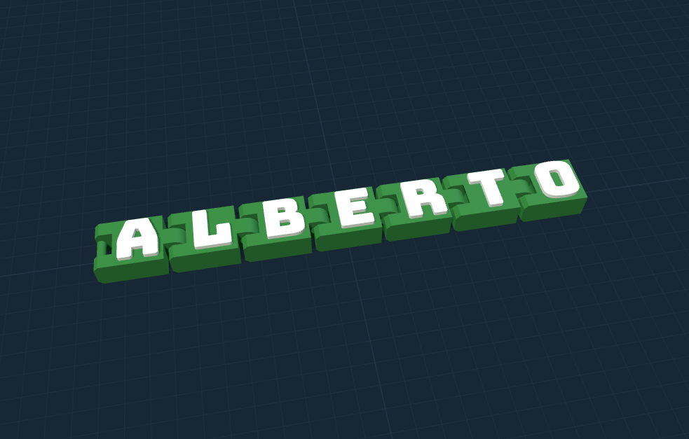
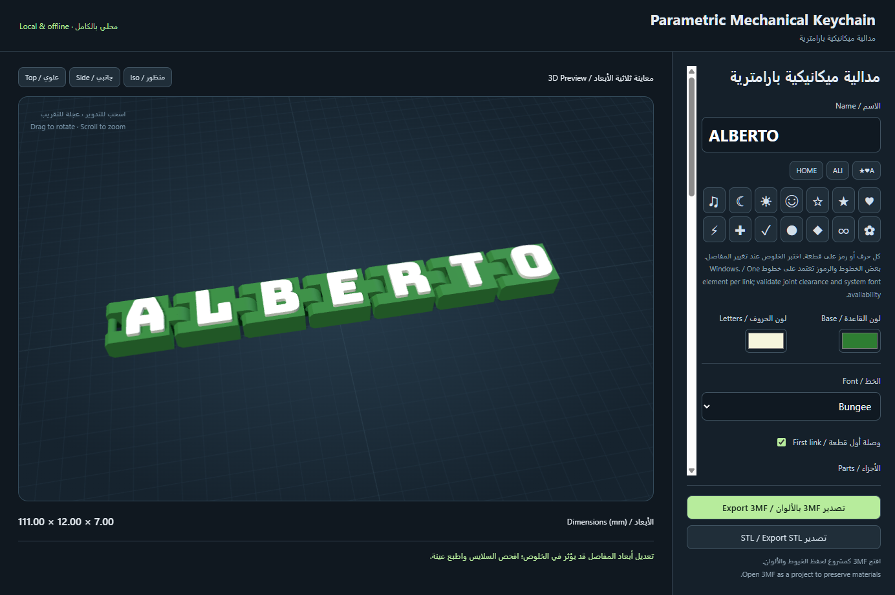

# Parametric Mechanical Keychain

مدالية ميكانيكية بارامترية

[العربية](README.ar.md) · [Download Windows EXE](https://github.com/music-dj/parametric-mechanical-keychain/releases/latest)

Create an articulated block keychain with one character or symbol per link. Based on the supplied Alberto Nicas OpenSCAD template, with a separate symbol extension. Includes a real 16-font dropdown, 14 insert/replace symbol buttons, relief or engraving, base/text/all modes, first-link toggle, and the complete link, cavity, axle, ring, support, spacing and chamfer settings.





## Windows quick start

1. Download the Windows ZIP from [Releases](https://github.com/music-dj/parametric-mechanical-keychain/releases/latest).
2. Extract the complete ZIP into a normal folder.
3. Run `ParametricMechanicalKeychain.exe`; keep its other files beside it.
4. Enter your name, adjust settings, rotate the preview, then export STL or colored 3MF.

Runs locally without an account or internet connection. This portable release is unsigned. It has no installer.

## Export

All dimensions are millimeters. STL contains geometry only. 3MF contains separately colored volumes plus Bambu Studio/OrcaSlicer filament metadata. Open 3MF as a project and review material assignments. Printer profiles and filament calibration are not supplied; slicers can interpret color metadata differently. Example files are in [examples](examples).

## Settings

Name and both color pickers are always available.

| Setting | Label | Default |
| --- | --- | --- |
| `mechanicalFont` | الخط / Font | `Bungee` |
| `eslabon_primer_elemento` | وصلة أول قطعة / First link | `true` |
| `mechanicalMode` | الأجزاء / Parts | `todo` |
| `tamano_letra` | حجم الخط (mm) | `10` |
| `altura_letra` | ارتفاع النص (+ بارز / − محفور) (mm) | `1` |
| `alto` | سماكة القطعة Z (mm) | `6` |
| `ancho` | عرض القطعة Y (mm) | `12` |
| `largo` | طول القطعة X (mm) | `15` |
| `diametro_agujero` | قطر تجويف المفصل (mm) | `10` |
| `profundidad_agujero` | طول تجويف المفصل (mm) | `5.5` |
| `diametro` | قطر محور المفصل (mm) | `2` |
| `espacio_entre_modelos` | المسافة بين القطع (mm) | `1` |
| `diametro_externo_cilindro` | قطر حلقة الوصلة الخارجي (mm) | `6` |
| `diametro_interno_cilindro` | قطر حلقة الوصلة الداخلي (mm) | `3` |
| `altura_cilindro` | عرض حلقة الوصلة (mm) | `4` |
| `separacion_cilindro` | إزاحة الحلقة عن القطعة (mm) | `2` |
| `alto_soporte` | سماكة دعامة الحلقة (mm) | `1` |
| `largo_soporte` | طول دعامة الحلقة (mm) | `2` |
| `tamano_chaflan` | شطفة طرف القطعة (mm) | `1` |

## Limits

Bungee is bundled. Additional named fonts and Segoe UI Symbol depend on installed Windows fonts; unavailable fonts can fall back through OpenSCAD. A font change can alter fit. Validate clearances after changing hinge dimensions. This design is character-per-link, not joined Arabic calligraphy.

## Run from source

Requires Node.js 22+ and npm.

```powershell
npm ci
npm start
```

Install OpenSCAD 2021.01 and set `OPENSCAD_PATH` to its executable, or put its Windows installation in `runtime/openscad/`. The Windows release already bundles the engine.

## Test and package

```powershell
npm test
npm run test:ui
npm run build:windows
```
The build script creates a portable Windows folder in `dist/parametric-mechanical-keychain-windows`. Set `OPENSCAD_DIR` to the OpenSCAD installation directory before building. Set `ELECTRON_DIST` only when using an existing Electron runtime. Keep the complete output folder together.

Geometry checks cover 7 configurations, closed positive-volume meshes, invalid inputs, STL, and colored 3MF. UI checks cover initial load, fields, edits, reset, and both exports. The packaged Windows executable is also tested. Reports: [geometry](docs/geometry-test.json), [interface](docs/ui-test.json). Physical printing has not been tested.

## Source and attribution

The app is a standalone extraction of one generator from Keychain Studio. Only this generator is included; it has its own entry point and settings. Application code is covered by [LICENSE](LICENSE), subject to the exclusions and asset/model ownership in [ATTRIBUTION.md](ATTRIBUTION.md). Font licenses are included in `assets`. OpenSCAD remains a separate GPL program; see [OpenSCAD source](https://github.com/openscad/openscad/tree/openscad-2021.01).
